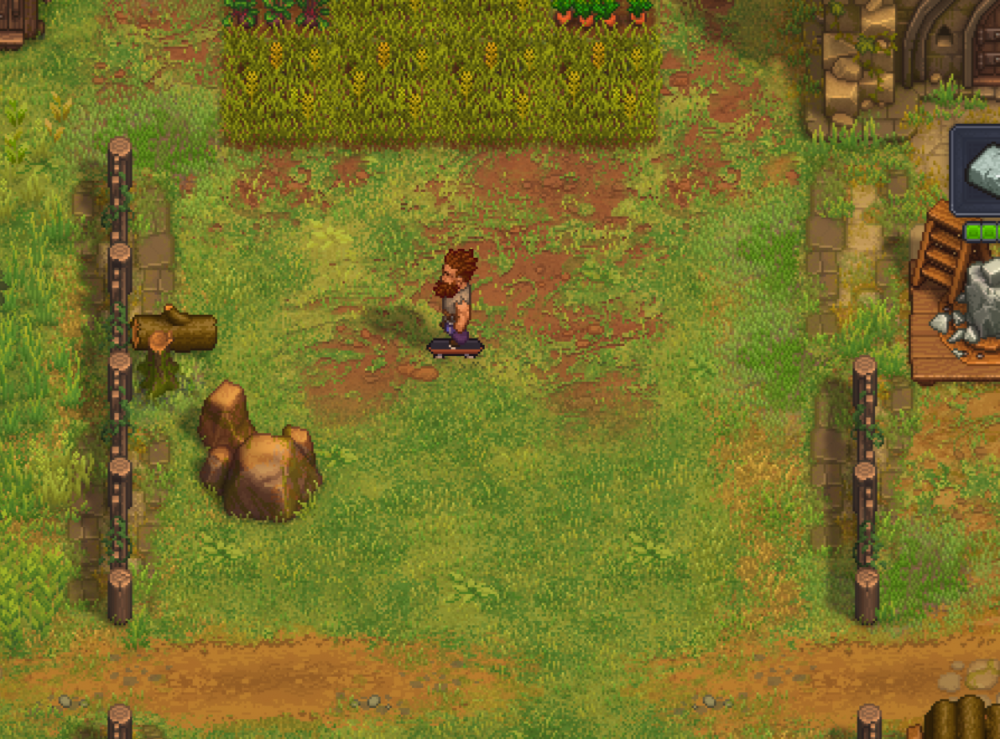

# Skateboard for Graveyard Keeper 2

A BepInEx mod that lets the keeper ride a skateboard around the graveyard.



## Controls

| Action | Keyboard | Gamepad |
|---|---|---|
| Get on / off | K | L3 (click left stick) |
| Ollie | Space | RT |

You can change these in `BepInEx/config/sean.gk2.skateboard.cfg`. The same file also holds speed, acceleration, coasting, turning, braking, ride height, ollie height and volume.

## Install

### With a mod manager (easiest)
1. Install [r2modman](https://thunderstore.io/package/ebkr/r2modman/) or the Thunderstore app, and pick Graveyard Keeper 2.
2. Search for **Skateboard** and click Install. BepInEx comes with it.
3. Start the game from the mod manager. Press **K** in game to ride.

### Manual
1. **Find the game folder.** In Steam, right-click Graveyard Keeper 2, then Manage, then Browse local files. It's the folder with `GraveyardKeeper2.exe`.
2. **Install BepInEx.**
   - Download [BepInExPack](https://thunderstore.io/c/graveyard-keeper-2/p/BepInEx/BepInExPack/) and open the zip.
   - Copy everything inside its `BepInExPack` folder into the game folder: the `BepInEx` folder, `winhttp.dll` and `doorstop_config.ini`.
3. **Run the game once, then close it.** This creates the `BepInEx/plugins` folder.
4. **Add the mod.**
   - Download `GK2Skateboard.dll` from the [latest release](https://github.com/scheissgeist/gk2-skateboard/releases/latest).
   - Put it in `BepInEx/plugins/GK2Skateboard/` (create that folder if it isn't there).
5. **Check it loaded.** Start the game and open `BepInEx/LogOutput.log`. It should contain `Skateboard 1.0.0 loaded`. Load a save and press **K**.

### Uninstall
Delete the `BepInEx/plugins/GK2Skateboard` folder. The mod changes nothing in your save.

To remove BepInEx completely, also delete `BepInEx/`, `winhttp.dll`, `doorstop_config.ini` and `.doorstop_version` from the game folder.

## How it works

- **Movement:** Harmony patches on `PlayerPhysicalBody` take over the keeper's ground velocity while riding. That's where acceleration, carving, braking and coasting happen.
- **Board graphic:** a sprite under `PlayerView`. It copies the keeper's material and pixel grid, and switches between side and end-on views with the keeper's own 4-way facing.
- **Gamepad:** buttons are read directly over XInput, so they never share a binding with game actions.
- **Sound:** goes through the game's SFX mixer group, so the SFX volume setting applies.

## Build

You need the .NET SDK and Graveyard Keeper 2 with BepInEx installed.

```
dotnet build -c Release
```

The build copies the DLL into the game's `BepInEx/plugins/GK2Skateboard/` folder. Pass `-p:GameDir=...` if the game isn't in the default Steam location.

- **Art:** the board sprites are generated from `tools/make_art.py` into `art/skateboard.png`.
- **Package:** the Thunderstore package files are in `release/pkg/`.

## Credits

All sounds are CC0 recordings from Freesound:

- "SkateRolling.wav" by Lanterr
- "skateboard ollie" by nolimitkid

Links are in `sfx/CREDITS.md`.
